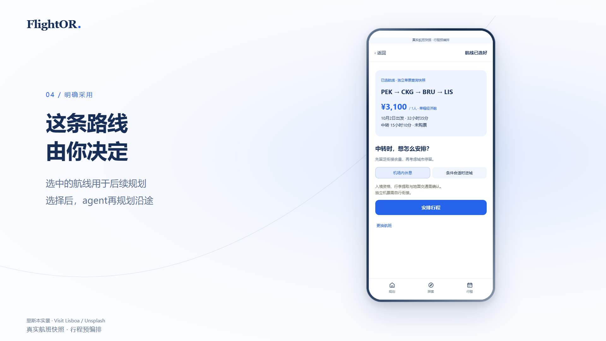

## 项目简介

FlightOR 是一个做国际航线比价和多城行程规划的微信小程序。用户输入出发地、日期、人数、预算和偏好后，系统会先搜索航班，把多城路线、中转停留和沿途城市放在一起比较。选定一条航线后，再继续安排每天怎么玩。

这样处理的好处很直接：先确认机票有没有合适的组合，再决定酒店和行程，不会把路线做得很好看，最后却买不到票。

## 我的工作

我主要做小程序端的规划体验，也参与了后端接口、Agent 会话语义和行程数据结构的联调。

- 把规划页做成启动页，让用户从一句需求开始，通过多轮对话补全日期、预算、区域和兴趣
- 接入独立后端，把规划请求交给两个 DSH Agent 分别整理和审核，再把结果映射到小程序里的路线卡与行程页
- 处理结构化返回里的航班、推荐路线、攻略附件和警告信息，保证历史轮次仍能正常查看
- 在会话切换、重新发送和报价确认时处理请求失效，避免旧结果覆盖当前行程
- 把会话缓存限制在本机，并对损坏或不完整的数据做校验和忽略

## 实现方式

前端使用 Taro、React 和 MobX，后端使用 Fastify。小程序不直接保存第三方密钥，也不直接连接航班搜索服务；航班需求和实时数据都通过自建后端处理。

```text
小程序 / Taro + React + MobX
              ↕ HTTP
Fastify 后端 / Agent 会话 / 航班搜索
              ↕
DSH 规划 Agent + 审核 Agent + trip-flight-tool
```

规划结果会保留用户的原始需求、当前理解、路线卡和攻略卡。用户确认一条航线后，行程页再围绕这条航线展开，中转休息、进城条件和沿途安排也会作为后续决策的一部分。



*选中航线后，用户可以决定中转换乘怎么安排，再继续生成沿途行程。*

## 当前状态

项目目前是可运行的 MVP，已打通小程序前端、自建后端和航班搜索链路。探索、收藏和提醒仍以演示数据为主，业务登录、多用户隔离和完整真机验收还没有做到生产版本。

## 技术关键词

Taro / React / MobX / TypeScript / Fastify / DSH Agent / 微信小程序 / 多城路线规划 / 结构化会话 / 机票搜索
